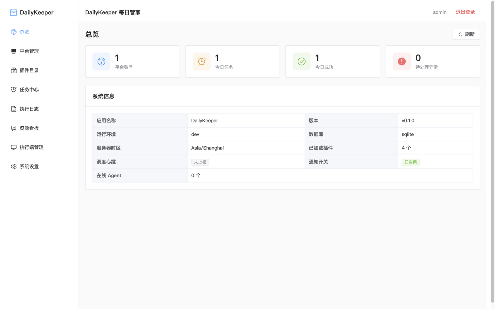
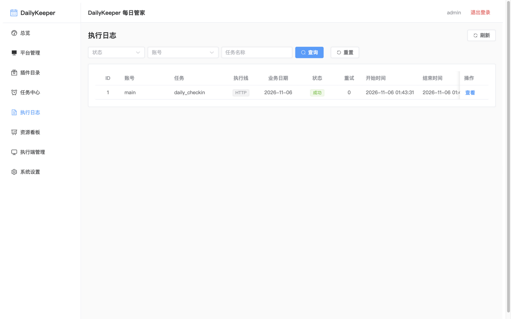
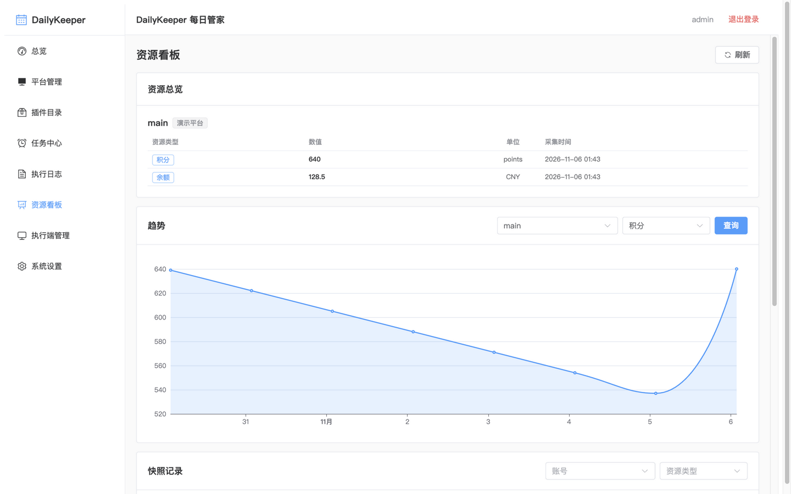
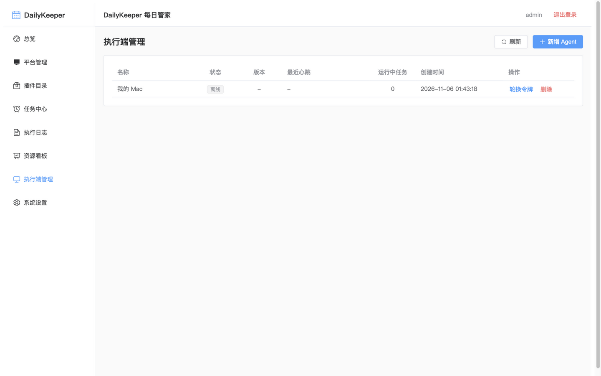

# DailyKeeper

**One Platform. All Your Daily Tasks.** —— 一个平台，搞定所有每日任务。

DailyKeeper 是一个自托管的可扩展自动化平台：统一管理多平台账号，自动执行网站、在线服务与桌面应用上的例行任务。

账号管理、每日签到服务、定时任务、执行记录、资源监控与跨平台自动化，全部收敛进一个控制台。

- **[在线主页](https://ahao430.github.io/DailyKeeper/)** —— GitHub Pages 自动部署

## 功能特性

- **多平台管理** —— 在一处管理来自不同平台的账号与服务。
- **每日任务自动化** —— 自动执行每日签到、福利领取与例行操作。
- **账号凭据管理** —— 统一管理认证凭据、会话与登录状态（AES-GCM 加密存储）。
- **资源监控** —— 跟踪余额、积分、额度、用量与过期时间，附趋势图表。
- **可扩展插件体系** —— 通过统一插件 SDK 接入新平台与新能力，无需改动核心引擎。
- **浏览器自动化** —— 专用浏览器 Worker 基于 Playwright 自动化网页工作流，按账号持久化登录态。
- **本地 Agent** —— 拉取式本地 Agent（`dk-agent`）把自动化延伸到桌面应用。
- **MCP Server** —— 通过 MCP（`dk-mcp`）向 AI 助手开放签到状态查询、任务触发与余额查询。
- **多用户管理** —— 多管理员账号，停用/删除后令牌即时失效。
- **通知推送** —— Bark / ntfy / Gotify / 邮件（SMTP）/ Webhook，按事件独立开关。
- **自托管** —— 部署并管理属于你自己的自动化服务。

## 管理后台

内置 Vue 3 + Element Plus 管理后台，八个页面覆盖日常运维全部操作，以下均为真实界面截图：

<p align="center"></p>

**总览** —— 平台账号数、今日任务/成功数、待处理异常、系统信息与调度心跳。

<p align="center">
  
  
</p>

**执行日志** —— 每次任务的状态、结果消息、执行线（HTTP / 浏览器 / Agent）与重试次数，支持按账号/任务/状态过滤。**资源看板** —— 余额、积分、额度等资源最新值汇总与 ECharts 趋势图。

<p align="center"></p>

**执行端管理** —— 本地 Agent 注册、令牌一次性下发/轮换/撤销与在线状态。

其余页面：**平台管理**（多实例 + 插件动态表单）、**任务中心**（定时任务 CRUD 与立即执行）、**插件目录**（可信白名单 + 升级提示）、**系统设置**（通知渠道、事件开关、用户管理、修改密码）。

## 技术栈

- 后端：Python 3.12+、FastAPI
- Monorepo：backend / sdk / plugins / local-agent / mcp-server / frontend / deploy / docs
- 数据库：SQLite（已为 PostgreSQL 预留）
- 浏览器自动化：Playwright（browser worker）
- 任务调度：APScheduler
- 部署：Docker Compose
- 许可证：MIT

## 快速开始（Docker Compose）

```bash
git clone git@github.com:ahao430/DailyKeeper.git
cd DailyKeeper
cp deploy/.env.example deploy/.env
docker compose -f deploy/docker-compose.yml up -d --build
# Dashboard: http://localhost:8080
# Swagger UI: http://localhost:8000/docs
```

## 快速开始（源码运行）

```bash
python3.12 -m venv .venv
source .venv/bin/activate
pip install -e sdk -e plugins/demo -e plugins/newapi -e plugins/mteam -e plugins/nexusphp -e backend
uvicorn app.main:app --reload
# Swagger UI: http://localhost:8000/docs
# 默认管理员 admin / admin123，首次登录后请修改密码

# 前端开发服务（新开终端）
cd frontend && npm install && npm run dev
# Dashboard: http://localhost:5173
```

## 项目结构

```
dailykeeper/
├── backend/        # DailyKeeper Server
├── sdk/            # DailyKeeper SDK
├── plugins/        # DailyKeeper Plugins
├── local-agent/    # DailyKeeper Agent（dk-agent，拉取式本地执行端）
├── mcp-server/     # DailyKeeper MCP Server（dk-mcp，stdio）
├── frontend/       # DailyKeeper Dashboard（Vue 3 + Element Plus）
├── homepage/       # 项目主页（GitHub Pages 自动部署）
├── deploy/         # Docker Compose 部署（api / scheduler / worker / browser-worker）
└── docs/           # PRD、ARCHITECTURE、PLUGIN_SDK、DATABASE、API、DEPLOYMENT
```

## 文档

- [项目主页](https://ahao430.github.io/DailyKeeper/) —— 自动部署到 GitHub Pages
- [PRD](docs/PRD.md) —— 产品需求与功能边界
- [ARCHITECTURE](docs/ARCHITECTURE.md) —— 系统架构与模块边界
- [PLUGIN_SDK](docs/PLUGIN_SDK.md) —— 插件接口、注册与开发指南
- [DATABASE](docs/DATABASE.md) —— 数据模型与关系
- [API](docs/API.md) —— 认证、平台、账号、任务、执行、资源、系统
- [MCP](docs/MCP.md) —— MCP Server（dk-mcp）AI 助手接入
- [DEPLOYMENT](docs/DEPLOYMENT.md) —— Docker Compose 部署指南
- [plan.md](plan.md) —— 原始项目规划（V1.0）
