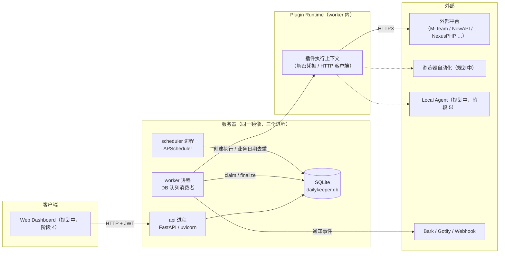

# DailyKeeper 系统架构

> 本文描述 DailyKeeper V1 的总体形态、技术选型、模块边界、任务执行流程与安全边界。

## 一、总体形态

DailyKeeper 采用**模块化单体（Modular Monolith）**架构，而不是一开始就拆分微服务：清晰的模块边界 + 单一部署单元，避免前期运维成本。

- **三进程模型**：`api`（uvicorn 提供 REST API）、`scheduler`（`python -m app.scheduler`，APScheduler 定时扫描）、`worker`（`python -m app.worker`，DB 队列消费者）。三个进程共用同一个镜像，通过 SQLite 数据库队列协作。
- **SQLite 数据库队列**：APScheduler 只负责产生定时任务，任务队列与执行状态保存在 `task_executions` 表中，Worker 通过数据库事务（乐观锁 claim）领取任务，天然保证领取不重复。
- **双执行环境路线图**：V1 由服务器直接执行 API 类任务（HTTP 插件）；后续版本引入浏览器执行（Playwright）与本地 Agent（Mac/Windows），覆盖依赖本机登录态的桌面应用场景。

## 二、技术选型

| 层级 | 技术 | 说明 |
| --- | --- | --- |
| 后端 | Python 3.12+ | 核心开发语言 |
| API | FastAPI | REST API |
| ORM | SQLAlchemy 2.x | 数据库访问 |
| 校验 | Pydantic 2.x | 配置与数据校验 |
| 调度 | APScheduler | 定时任务 |
| HTTP | HTTPX | API 请求 |
| 浏览器 | Playwright | 网页自动化（规划中） |
| 数据库 | SQLite | 初期部署 |
| 迁移 | Alembic | 数据库版本管理 |
| 前端 | Vue 3 | 管理界面（阶段 4 规划） |
| UI | Element Plus | 管理组件（阶段 4 规划） |
| 部署 | Docker Compose | 容器化 |
| 通知 | Bark / Gotify / Webhook | 消息推送 |

暂时不需要 Redis、Celery、Kubernetes。注意：Scheduler 和 Worker 必须分离运行，不能让 APScheduler 在多个 API 实例中重复调度。

## 三、系统架构图

## 四、模块边界

| 模块 | 职责 |
| --- | --- |
| `backend/app/api/` | REST 路由层：认证、平台、账号、任务、执行记录、资源、系统设置的 HTTP 接口 |
| `backend/app/services/` | 业务服务层：任务引擎、凭据加解密、执行编排，被 api/scheduler/worker 复用 |
| `backend/app/models/` | SQLAlchemy ORM 表定义（唯一的数据模型来源） |
| `backend/app/scheduler/` | APScheduler 入口：扫描 scheduled_tasks，按业务日期创建 task_executions |
| `backend/app/worker/` | Worker 入口：轮询领取 PENDING 任务，调用插件执行并 finalize |
| `backend/app/notifications/` | 通知模块：Bark / Gotify / Webhook 渠道与事件开关 |
| `sdk/dailykeeper_sdk/` | 插件 SDK：PlatformPlugin 基类、TaskContext、TaskResult、注册表 |
| `plugins/` | 官方插件包：demo / newapi / mteam / nexusphp，经 entry points 注册 |

## 五、任务执行流程

1. **Scheduler 扫描**：scheduler 进程按固定间隔（默认 30s）扫描 `scheduled_tasks`，对到期任务计算站点时区下的 `business_date`。
2. **create_execution（业务日期去重）**：为该账号 + 任务 + 业务日期创建 `task_executions` 行；若已存在去重状态（`DEDUPE_STATUSES`）内的记录则跳过，保证同一天只执行一次。
3. **Worker claim（乐观锁更新 claim）**：worker 进程轮询 PENDING 且到期的执行记录，通过条件更新（乐观锁）抢占任务并写入 `worker_id`，多 worker 不会重复领取。
4. **Plugin Runtime 构建上下文（解密凭据）**：引擎加载该平台插件，解密 AES-GCM 凭据，组装 `TaskContext`（凭据、实例配置、base_url、HTTP 客户端、日志）。
5. **plugin.execute**：调用插件的 `execute(task_name, context)`，返回统一的 `TaskResult`；`requires_browser` 的任务在 V1 直接返回 `NEEDS_ACTION` 等待浏览器自动化版本。
6. **finalize（结果 / 账号状态 / 资源快照 / 通知 / 重试）**：保存 `task_results`；按结果更新账号状态（如 `AUTH_EXPIRED`）；持久化 `result.data["resources"]` 为资源快照；按事件开关发送通知；可重试失败按退避策略创建新的执行记录（`retries + 1`）。

## 六、执行保护机制

| 保护机制 | 说明 | V1 状态 |
| --- | --- | --- |
| 任务去重 | 同一账号、同一任务、同一业务日期只执行一次（去重状态内） | ✅ V1 实现（`ix_task_executions_dedupe` + DEDUPE_STATUSES） |
| 执行锁 | 避免同一账号同时执行多个任务 | ✅ V1 实现（claim 乐观锁 + 状态机） |
| 超时控制 | HTTP 与浏览器任务分别设置超时 | ✅ V1 实现（`task_timeout_seconds` / `http_timeout`；浏览器超时随浏览器版本） |
| 重试策略 | 网络错误可重试；签到提交成功但响应不明确时不能重复提交 | ✅ V1 实现（幂等任务才允许重试，重试为新执行行） |
| 限流控制 | 每个平台独立设置并发数和请求间隔 | 🗺 规划（V1 按平台并发规划，先以单 worker 串行保平安） |
| 任务恢复 | 服务重启后识别中断任务，判断能否安全恢复 | ✅ V1 实现（重启后 RUNNING → INTERRUPTED，允许重跑） |
| 人工接管 | 验证码、二次验证等情况进入待处理状态 | ✅ V1 实现（`NEEDS_ACTION` 状态 + 通知） |

## 七、数据流与安全边界

- **凭据加密**：Cookie / 密码 / API Key 使用 AES-GCM 加密存储，密文带 `enc1:` 版本前缀；加密密钥来自 `DAILYKEEPER_SECRET_KEY`（或独立的 `DAILYKEEPER_ENCRYPTION_KEY`），支持密钥轮换。
- **日志脱敏**：任务记录与日志不落明文凭据，错误信息经过滤后入库。
- **管理端认证**：API 使用 JWT 管理员认证（`/api/auth/login`），`/healthz` 等探活端点公开。
- **插件白名单**：V1 仅加载随镜像分发的官方插件（demo / newapi / mteam / nexusphp），即「可信插件白名单」；插件之间不共享认证信息。
- **不绕过平台安全措施**：不自动处理验证码，不自动绕过二次验证，需要人工的场景统一进入 `NEEDS_ACTION`。

## 八、后续演进

- **Local Agent（阶段 5）**：Mac / Windows 本地执行端，与服务器共享 DailyKeeper SDK，通过 HTTPS/WebSocket **主动连接**服务器领取浏览器/桌面自动化任务（Agent 表与心跳字段已预留）。
- **MCP 服务**：将任务状态与资源数据通过 MCP 暴露给 AI 助手。
- **Redis / Celery**：并发量明显增加后再替换 SQLite 队列。
- **PostgreSQL**：多实例部署或数据量增长后迁移，ORM 层已按可移植性编写。
- **Alembic 迁移管理**：Alembic 已引入，后续 schema 变更统一走迁移脚本而非建表脚本。
